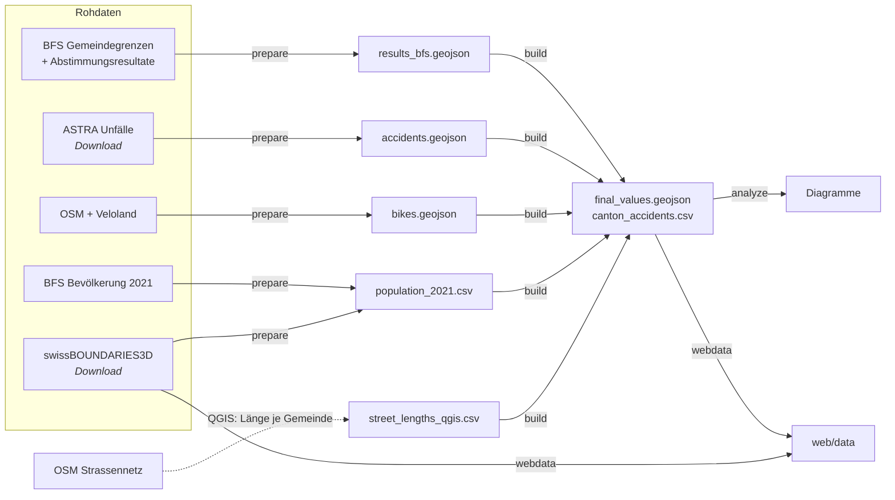

# Velowege-Abstimmung 2018: räumliche Analyse

[](https://teefaxx.github.io/projekt-gis-karto/)
[](https://teefaxx.github.io/projekt-gis-karto/bericht.pdf)
[](https://github.com/teefaxx/projekt-gis-karto/actions/workflows/ci.yml)

Projekt **GIS & Kartografie** (ETH Zürich, FS 2023) · Dario De Luca

Wie hängen die Gemeinde-Resultate zum *Bundesbeschluss über die Velowege sowie die Fuss- und
Wanderwege* (23.&nbsp;September 2018, 73.6&nbsp;% Ja) mit der vorhandenen Veloinfrastruktur und den
Velounfällen zusammen?

[](https://teefaxx.github.io/projekt-gis-karto/)

## Ergebnis in Kürze

Zwischen dem Ja-Anteil einer Gemeinde und ihrem Veloweg-Anteil am Strassennetz besteht **kein
nennenswerter Zusammenhang** (Pearson r&nbsp;=&nbsp;0.07, n&nbsp;=&nbsp;2131). Auch mit den Velounfällen
pro 100'000 Einwohner gibt es keinen (r&nbsp;=&nbsp;−0.10). Die Zustimmung lässt sich eher durch
sozioökonomische Faktoren erklären. Details stehen im [Projektbericht](reports/FS23_Proj_GIS_Karto_Bericht_Dario_DeLuca.pdf).

| Klasse | Velowege ≥ 6.46&nbsp;% des Strassennetzes | Ja-Anteil ≥ 71&nbsp;% | Gemeinden |
|---|:-:|:-:|--:|
| dunkelgrün | ja | ja | 366 |
| hellviolett | ja | nein | 323 |
| hellgrün | nein | ja | 675 |
| dunkelviolett | nein | nein | 767 |
| grau | – | keine eigenen Resultate (gemeinsame Urne) | 5 |

<sub>Schwellen: Veloweg-Anteil = Mittel der sechs [Prix-Velo-Städte](https://www.prixvelo.ch/de/prix-velo-infrastruktur);
Ja-Anteil = ungewichtetes Mittel der Gemeinden mit eigenem Resultat (gerundet).</sub>

> [!NOTE]
> Die Zahlen weichen leicht vom Bericht (2023) ab, weil vier Fehler der Originalauswertung
> korrigiert wurden (siehe [Korrekturen](#korrekturen-gegenüber-dem-bericht-2023)). Die Aussage
> bleibt gleich.

## Interaktive Webkarte

**→ [teefaxx.github.io/projekt-gis-karto](https://teefaxx.github.io/projekt-gis-karto/)**

Die Webkarte übernimmt die Gestaltung der gedruckten Karte ([`map/`](map/)) und basiert auf
[MapLibre GL JS](https://maplibre.org/). Sie braucht keinen Build-Schritt und keinen API-Token.

- **Gemeinden:** Dargestellt sind die offiziellen Gemeindegrenzen
  ([swissBOUNDARIES3D](https://www.swisstopo.admin.ch/de/landschaftsmodell-swissboundaries3d),
  Stand 1.1.2023) als Vektorkacheln. In hohen Zoomstufen entsprechen sie den Originaldaten
  (~1.6&nbsp;m). Seen und Flüsse stammen aus der swisstopo-Basiskarte, deshalb passen
  Gemeindeflächen und Ufer lückenlos zusammen.
- **Hintergrund:** wahlweise ohne (wie die Druckkarte), swisstopo-Basiskarte (Vektor), Landeskarte
  farbig oder grau, oder das Luftbild SWISSIMAGE.
- **Details:** Ein Klick auf eine Gemeinde zeigt Ja-Anteil, Stimmen, Veloweg-Anteil, Unfälle und
  Einwohnerzahl im Vergleich zu den Schwellenwerten.
- **Suche und Direktlinks:** Gemeindesuche mit Tastatursteuerung, Direktlinks wie
  [`#gemeinde=159`](https://teefaxx.github.io/projekt-gis-karto/#gemeinde=159).
- **Legende:** Klassen lassen sich ein- und ausblenden. Dazu kommen Kantonssymbole mit Unfallraten.
- **Bericht:** Der Projektbericht öffnet sich als PDF im Browser.
- Die Karte funktioniert auch auf dem Handy.


Lokal starten:

```bash
cp reports/FS23_Proj_GIS_Karto_Bericht_Dario_DeLuca.pdf web/bericht.pdf   # optional, für den PDF-Link
python -m http.server -d web 8000                                          # → http://localhost:8000
```

Veröffentlicht wird automatisch über GitHub Pages ([`pages.yml`](.github/workflows/pages.yml)),
sobald `web/` oder `reports/` auf `main` geändert wird. Der Workflow kopiert den Bericht nach
`bericht.pdf`. Dafür muss unter *Settings → Pages* als Quelle „GitHub Actions“ gewählt sein.

## Repository-Struktur

```
├── pipeline/            Python-Datenverarbeitung (python -m pipeline …)
│   ├── prepare.py       Rohdaten → data/interim/ (lädt öffentliche Daten selbst herunter)
│   ├── build.py         data/interim/ → data/processed/ (Kennzahlen, Klassifikation)
│   ├── analysis.py      Korrelationen und Diagramme
│   └── webdata.py       Vektorkacheln und JSON für die Webkarte
├── data/
│   ├── raw/             Rohdaten (nicht versioniert)
│   ├── interim/         bereinigte Zwischenstände
│   └── processed/       final_values.geojson, canton_accidents.csv
├── web/                 interaktive Webkarte (statisch, MapLibre)
├── map/                 gedruckte Karte (Stand Bericht 2023): QGIS-Projekt und Affinity-Dateien
├── reports/             Projektbericht (PDF) und Diagramme
└── tests/               prüft Reproduzierbarkeit und die Korrekturen
```

## Datenverarbeitung

```bash
pip install -e ".[dev]"        # oder: pip install -r requirements.txt
python -m pipeline prepare     # Unfälle (ASTRA) und Gemeindegrenzen laden, data/interim aktualisieren
python -m pipeline build       # data/interim → data/processed   (~5 s)
python -m pipeline analyze     # Korrelationen + reports/figures/
python -m pipeline webdata     # web/data/ (Vektorkacheln, ~40 s)
pytest
```



Die frühere Kette aus acht Skripten, einem ArcGIS-Schritt und Zwischen-GeoJSONs
(`export/master/*`) ist jetzt ein einziger `build`-Schritt im Speicher. Die Veloweglängen pro
Gemeinde werden direkt in Python berechnet (Verschneidung der Velowege mit den Gemeindeflächen).
Einzig die Strassennetzlängen stammen weiterhin aus einem manuellen QGIS-Schritt
(`data/interim/street_lengths_qgis.csv`).

**Rohdaten.** Unfälle (ASTRA) und Gemeindegrenzen (swisstopo) lädt `prepare` selbst von
[data.geo.admin.ch](https://data.geo.admin.ch). Die übrigen Rohdaten (ehemals `data.zip`:
Abstimmungs-Excel, BFS-Gemeindegrenzen g1g23, OSM, Veloland) sind nicht im Repository, der
ursprüngliche Download-Link ist abgelaufen. Ohne sie überspringt `prepare` die betroffenen Schritte
und nutzt die versionierten Zwischenstände.

### Korrekturen gegenüber dem Bericht (2023)

| | vorher | jetzt |
|---|---|---|
| **Unfallzeitraum** | `Monat ≤ 9 & Jahr ≤ 2018` liess Oktober bis Dezember *jedes* Jahres weg (25'121 Unfälle) | Januar 2011 bis und mit September 2018, also bis zur Abstimmung (30'108 Unfälle) |
| **Fehlende Werte** | Gemeinden mit gemeinsamer Urne zählten mit 0&nbsp;% Ja, auch beim Mittelwert | Ohne eigenes Resultat gibt es keine Klasse (grau); die Gemeinden fliessen nicht in den Mittelwert ein |
| **Velowege Genf** | Der ArcGIS-Schritt liess 9 Genfer Gemeinden aus und zählte in 3 weiteren nur einen Teil der Velowege | Berechnung in Python, in allen übrigen 1722 Gemeinden identisch mit ArcGIS. 9 Genfer Gemeinden wechseln in die Klasse „viele Velowege“ |
| **Bevölkerung** | 9 nach 2021 fusionierte Gemeinden ohne Einwohnerzahl, dadurch 0 Unfälle pro 100'000 EW | Einwohnerzahl aus swissBOUNDARIES3D 2023-01 ergänzt |
| **Unfälle je Kanton** | ungewichtetes Mittel der Gemeinderaten (eine Gemeinde mit 50 EW zählte gleich viel wie die Stadt Zürich) | Unfälle des Kantons ÷ Einwohner des Kantons |

Insgesamt wechseln 13 Gemeinden die Klasse: 9 in Genf und 4 ohne eigenes Resultat. Meienried
(gemeinsame Urne mit Büren an der Aare) ist neu als „keine Daten“ enthalten. Die gedruckte Karte
in `map/` zeigt weiterhin den Stand des Berichts.

**Offene methodische Punkte** (nicht geändert):

- Die Veloweglänge summiert OSM-Velowege und Veloland-Routen. Wo eine Veloland-Route auf einem
  OSM-Veloweg verläuft, wird doppelt gezählt. Veloland-Routen sind zudem oft normale Strassen.
- Die Ja-Schwelle ist das ungewichtete Mittel der Gemeinden (71&nbsp;%), nicht das nationale
  Resultat (73.6&nbsp;%).
- Die Unfälle werden mit den generalisierten BFS-Gemeindegrenzen (g1g23) den Gemeinden
  zugeordnet, gleich wie die Strassennetzlängen. Die Webkarte zeigt die exakten Grenzen.

## Datenquellen

Bundesamt für Statistik (BFS: Gemeindegrenzen, Abstimmungsresultate, Bevölkerung) ·
Bundesamt für Landestopografie swisstopo (swissBOUNDARIES3D, Basiskarten, Landeskarten, SWISSIMAGE) ·
Bundesamt für Strassen ASTRA (Strassenverkehrsunfälle mit Personenschaden) ·
Veloland Schweiz · © OpenStreetMap-Mitwirkende (ODbL)
