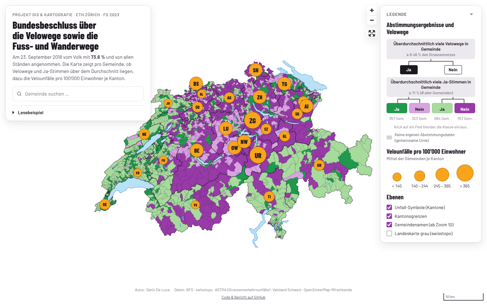
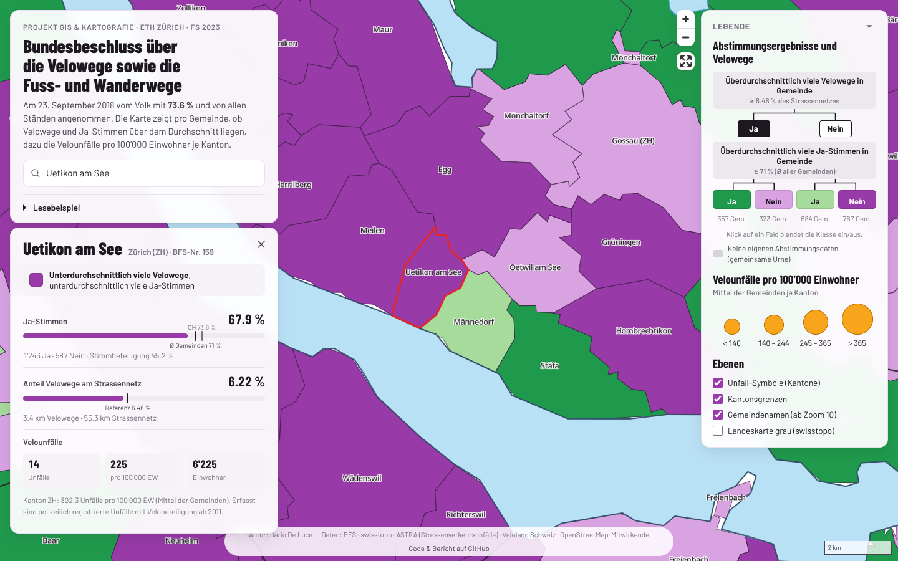
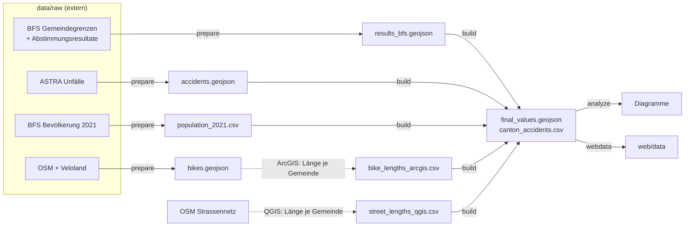

# Velowege-Abstimmung 2018: räumliche Analyse

[](https://teefaxx.github.io/projekt-gis-karto/)
[](reports/FS23_Proj_GIS_Karto_Bericht_Dario_DeLuca.pdf)
[](https://github.com/teefaxx/projekt-gis-karto/actions/workflows/ci.yml)

Projekt **GIS & Kartografie** (ETH Zürich, FS 2023) · Dario De Luca

Wie hängen die Gemeinde-Resultate zum *Bundesbeschluss über die Velowege sowie die Fuss- und
Wanderwege* (23.&nbsp;September 2018, 73.6&nbsp;% Ja) mit der vorhandenen Veloinfrastruktur und den
Velounfällen zusammen?

[](https://teefaxx.github.io/projekt-gis-karto/)

## Ergebnis in Kürze

Zwischen dem Ja-Anteil einer Gemeinde und ihrem Veloweg-Anteil am Strassennetz besteht **kein
nennenswerter Zusammenhang** (Pearson r&nbsp;=&nbsp;0.06, n&nbsp;=&nbsp;2135). Auch mit den Velounfällen
pro 100'000 Einwohner gibt es keinen (r&nbsp;=&nbsp;−0.12). Die Zustimmung lässt sich eher durch
sozioökonomische Faktoren erklären. Details stehen im [Projektbericht](reports/FS23_Proj_GIS_Karto_Bericht_Dario_DeLuca.pdf).

| Klasse | Velowege ≥ 6.46&nbsp;% des Strassennetzes | Ja-Anteil ≥ 71&nbsp;% | Gemeinden |
|---|:-:|:-:|--:|
| dunkelgrün | ja | ja | 357 |
| hellviolett | ja | nein | 324 |
| hellgrün | nein | ja | 684 |
| dunkelviolett | nein | nein | 770 |

<sub>Schwellen: Veloweg-Anteil = Mittel der sechs [Prix-Velo-Städte](https://www.prixvelo.ch/de/prix-velo-infrastruktur);
Ja-Anteil = ungewichtetes Mittel aller Gemeinden (gerundet).</sub>

## Interaktive Webkarte

**→ [teefaxx.github.io/projekt-gis-karto](https://teefaxx.github.io/projekt-gis-karto/)**

Die Webkarte übernimmt die Gestaltung der gedruckten Karte ([`map/`](map/)) und basiert auf
[MapLibre GL JS](https://maplibre.org/). Sie braucht keinen Build-Schritt und keinen API-Token.

- Ein Klick auf eine Gemeinde zeigt Ja-Anteil, Stimmen, Veloweg-Anteil, Unfälle und Einwohnerzahl
  im Vergleich zu den Schwellenwerten.
- Gemeindesuche mit Tastatursteuerung. Direktlinks sind möglich, z.&nbsp;B. [`#gemeinde=159`](https://teefaxx.github.io/projekt-gis-karto/#gemeinde=159) für Uetikon am See.
- Die Legende ist interaktiv: Klassen lassen sich ein- und ausblenden. Dazu kommen Kantonssymbole
  mit Unfallraten, Kantonsgrenzen, Gemeindenamen und optional die graue Landeskarte von swisstopo.
- Die Karte funktioniert auch auf dem Handy.



Lokal starten:

```bash
python -m http.server -d web 8000   # → http://localhost:8000
```

Veröffentlicht wird automatisch über GitHub Pages ([`pages.yml`](.github/workflows/pages.yml)),
sobald `web/` auf `main` geändert wird.

## Repository-Struktur

```
├── pipeline/            Python-Datenverarbeitung (python -m pipeline …)
│   ├── prepare.py       Rohdaten → data/interim/
│   ├── build.py         data/interim/ → data/processed/ (Klassifikation)
│   ├── analysis.py      Korrelationen und Diagramme
│   └── webdata.py       Export für die Webkarte (WGS84, vereinfacht)
├── data/
│   ├── raw/             Rohdaten (nicht versioniert, siehe unten)
│   ├── interim/         bereinigte Zwischenstände und Resultate der manuellen GIS-Schritte
│   └── processed/       final_values.geojson, canton_accidents.csv
├── web/                 interaktive Webkarte (statisch, MapLibre)
├── map/                 gedruckte Karte: QGIS-Projekt und Affinity-Dateien
├── reports/             Projektbericht (PDF) und Diagramme
└── tests/               Regressionstest: Pipeline reproduziert data/processed/ exakt
```

## Datenverarbeitung

```bash
pip install -e ".[dev]"        # oder: pip install -r requirements.txt
python -m pipeline build       # data/interim → data/processed   (~1 s)
python -m pipeline analyze     # Korrelationen + reports/figures/
python -m pipeline webdata     # web/data/*.geojson
python -m pipeline all         # alles (prepare nur, falls data/raw/ vorhanden)
pytest                         # prüft, dass build das veröffentlichte Resultat exakt reproduziert
```



Die frühere Kette aus acht Skripten und Zwischen-GeoJSONs (`export/master/*`) ist jetzt ein
einziger `build`-Schritt im Speicher. Das Resultat ist identisch: Der Test vergleicht alle 2135
Gemeinden, Werte und Geometrien.

**Manuelle GIS-Schritte.** Die Veloweglängen (ArcGIS) und die Strassennetzlängen (QGIS) pro
Gemeinde liegen als CSV in `data/interim/`. Die Veloweglängen lassen sich auch in Python
berechnen: `python -m pipeline build --recompute-bike-lengths`. Das liefert überall die gleichen
Werte, ausser in 12 Genfer Gemeinden, wo der ArcGIS-Schritt abweicht. Darum bleibt das CSV der
Standard.

**Rohdaten.** Die Rohdaten sind nicht im Repository, der ursprüngliche Download-Link ist
abgelaufen. `prepare` erwartet sie unter `data/raw/` (Pfade in [`pipeline/paths.py`](pipeline/paths.py)).
Alle weiteren Schritte laufen mit den versionierten Daten in `data/interim/`.

### Bekannte Einschränkungen der Originalauswertung

Diese Punkte wurden bewusst **nicht** geändert, damit die Resultate dem Bericht entsprechen:

- Der Unfallfilter `Monat ≤ 9 & Jahr ≤ 2018` schliesst Oktober bis Dezember *jedes* Jahres aus,
  nicht nur nach September 2018.
- Fehlende Werte werden vor der Klassifikation als 0 gezählt. Das betrifft fünf Gemeinden mit
  gemeinsamer Urne und Gemeinden ohne erfasste Velowege. In der Webkarte erscheinen die Gemeinden
  ohne eigenes Abstimmungsresultat grau.
- Neun Gemeinden ohne Bevölkerungszahl 2021 erhalten 0 Unfälle pro 100'000 EW. Diese Nullen
  fliessen in die Kantonsmittel ein.
- Die Ja-Schwelle ist das ungewichtete Mittel der Gemeinden (71&nbsp;%), nicht das nationale
  Resultat (73.6&nbsp;%).

## Datenquellen

Bundesamt für Statistik (BFS: Gemeindegrenzen, Abstimmungsresultate, Bevölkerung) ·
Bundesamt für Landestopografie swisstopo (Seen, Kantone) ·
Bundesamt für Strassen ASTRA (Strassenverkehrsunfälle) ·
Veloland Schweiz · © OpenStreetMap-Mitwirkende (ODbL)
